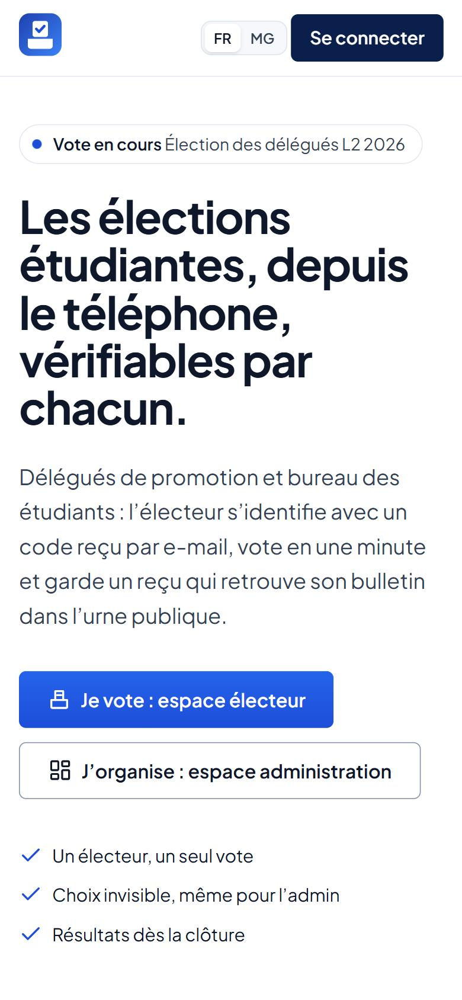
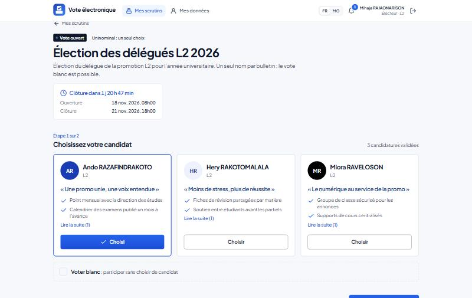
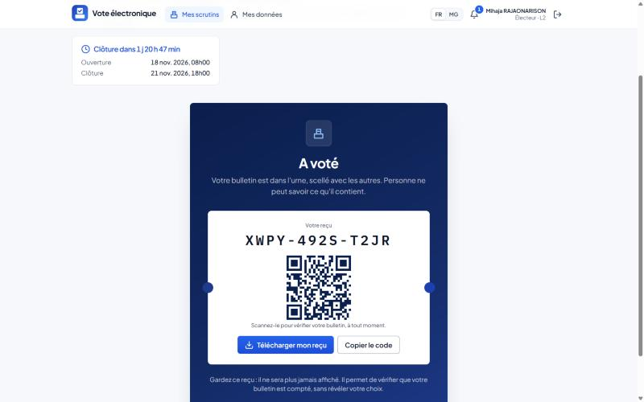
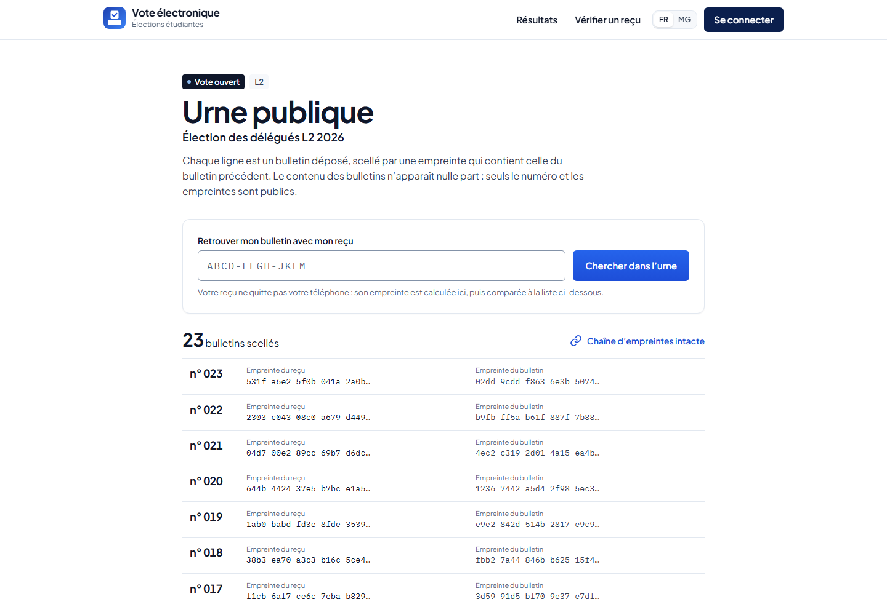
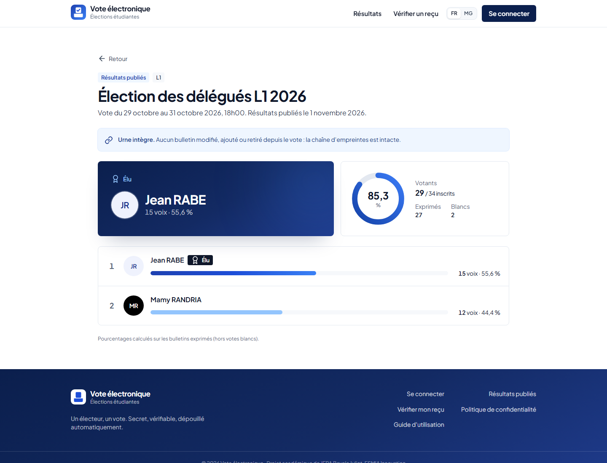
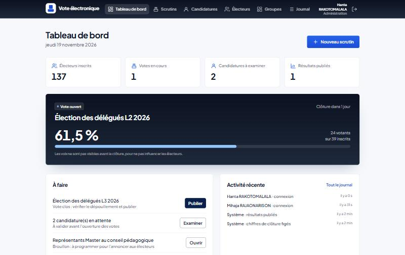

# Vote électronique

[](https://github.com/juliotjera/Vote_electronique/actions/workflows/tests.yml)
   

Application web d’**élections étudiantes** (délégués de classe, BDE, représentants) : **un électeur, un vote, secret et vérifiable**.

| Accueil | Sur téléphone |
| --- | --- |
|  |  |

| Choisir son candidat | Le reçu remis après le vote |
| --- | --- |
|  |  |

| Urne publique | Résultats |
| --- | --- |
|  |  |

| Connexion (choix du rôle) | Administration |
| --- | --- |
|  |  |

> Version refaite en **Laravel 13 + Livewire 4** du projet de vote électronique de Licence 1 (ESMIA INNOVATION), réalisé à l’origine en PHP procédural, en équipe de 3. Cette version est développée seul par JERA Bevala Juliot (2026).

## Ce qui change par rapport à la version de L1

| Version de L1 (PHP procédural) | Cette version |
| --- | --- |
| Table `votes` avec `electeur_id` **et** `candidat_id` : le vote n’était pas secret | **Urne en deux parties** : liste d’émargement (qui a voté) et bulletins anonymes (ce qui a été voté), sans aucune colonne commune |
| Colonne `a_vote` sur l’utilisateur (un seul scrutin possible) | Émargement par scrutin, **contrainte unique** en base contre le double vote, même simultané |
| Aucune preuve pour l’électeur | **Reçu** remis après le vote : il prouve que le bulletin est dans l’urne sans révéler le choix |
| Résultats modifiables en base sans trace | **Urne scellée** : chaque bulletin contient l’empreinte SHA-256 du précédent ; toute modification est détectée |
| Mot de passe | **Connexion sans mot de passe** : matricule + e-mail + code à usage unique (10 min, 5 essais) |
| Ouverture et clôture manuelles | Cycle automatique (brouillon → annoncé → ouvert → clos → publié), e-mails d’ouverture, **rappels personnalisés** (la veille ou le jour même) aux seuls abstentionnistes |
| Scrutins par classe | Scrutins pour des **classes et des groupes** (associations, clubs, comités dont les membres viennent de plusieurs classes) |
| — | Vote **uninominal ou plurinominal**, vote blanc, élus et égalités calculés |
| — | Données personnelles **supprimées 30 jours** après la clôture, comme promis dans la politique de confidentialité |
| Interface en français | Pages des électeurs en **français ou malagasy** (l’administration reste en français) |

Documents du projet :

- [`docs/CAHIER_DES_CHARGES.md`](docs/CAHIER_DES_CHARGES.md) : cahier des charges mis à jour ;
- [`docs/INSTALLATION.md`](docs/INSTALLATION.md) : installation en local et mise en production ;
- [`docs/RAPPORT_DE_TESTS.md`](docs/RAPPORT_DE_TESTS.md) : rapport de tests fonctionnels (exigence par exigence) ;
- [`docs/GUIDE_UTILISATEUR.pdf`](docs/GUIDE_UTILISATEUR.pdf) : guide d’utilisation, aussi consultable dans l’application (page « Guide d’utilisation »).

## Fonctionnalités

- **Électeur** : scrutins de sa classe et de ses groupes avec **compte à rebours** jusqu’à la clôture ; candidats (photo, slogan, engagements) ; vote en trois temps (choisir → vérifier son bulletin → déposer) ; **reçu avec code QR, téléchargeable en image** ; **urne publique** où il retrouve son bulletin avec son reçu ; résultats ; **cloche de notifications** ; consultation et correction de ses données ; **choix de ses rappels**.
- **Candidat** : dépôt et modification de sa candidature (photo recadrée et allégée, slogan, programme) jusqu’à la date limite ; motif en cas de refus.
- **Administration** : tableau de bord (participation en direct, jamais les voix avant la clôture) ; scrutins (création, programmation, publication) ; validation des candidatures ; liste électorale (recherche, activation, **import et export CSV** au format de la scolarité) ; **groupes** ; **liste d’émargement** (qui a voté et quel jour, jamais quoi ; export CSV) ; dépouillement ; **procès-verbal PDF** et export CSV ; contrôle d’intégrité de l’urne ; journal d’activité avec les **tentatives refusées** (connexions, codes, votes en double ; IP tronquée).
- **Public** : accueil avec **choix du rôle** (électeur ou administration), aperçu de l’écran de vote et **participation en direct** des votes que l’administration a rendus publics (jamais les voix) ; urne publique ; résultats publiés (élus mis en avant, anneau de participation) ; vérification d’un reçu ; politique de confidentialité ; **guide d’utilisation** (page et PDF).
- **Langues** : français et malagasy (`lang/mg.json`), bascule FR / MG dans l’en-tête.
- **Démonstration** : « Essayer sans compte » ouvre l’espace d’un électeur, d’un candidat ou de l’administration (désactivable : `COMPTES_DEMO=false`).

## Comment le vote reste secret et vérifiable

```
électeur ──► Urne::voter() ── une transaction, scrutin verrouillé ──┬─► emargements (scrutin, électeur, date du jour)
                                                                      └─► bulletins (UUID, rang, choix, empreinte du reçu,
                                                                                     SHA-256 du bulletin + du précédent)
```

- Aucun identifiant commun entre émargement et bulletin (UUID aléatoires), pas d’heure de vote, pas d’adresse IP dans l’urne.
- Les votes ne sont **pas** inscrits au journal d’activité : leur heure exacte, rapprochée du rang des bulletins, permettrait de retrouver un choix.
- Le reçu n’est jamais stocké en clair (seulement son empreinte) : la plateforme ne peut pas le relier à l’électeur. Son code QR et son image sont produits dans le navigateur ; le QR place le reçu après le « # » de l’adresse, partie jamais envoyée au serveur ni écrite dans ses journaux.
- `Urne::verifierIntegrite()` recalcule la chaîne et compare le nombre de bulletins au nombre d’émargements ; le résultat s’affiche sur les résultats, le procès-verbal et la page de vérification d’un reçu.

**Limites connues** (projet académique) : l’administrateur de la base peut toujours supprimer toute l’urne et la recalculer, et les journaux du serveur web gardent l’heure des requêtes. Un scrutin officiel demanderait un chiffrement de bout en bout (chiffrement homomorphe, réseaux de mélange) et des autorités de dépouillement indépendantes.

## Technologies

Laravel 13 (PHP 8.4) · Livewire 4 · Blade · Tailwind CSS 4 · Alpine.js · SQLite en développement, PostgreSQL en production · DomPDF · PHPUnit.

Interface légère pour les réseaux faibles : pages rendues par le serveur, polices hébergées avec l’application, graphiques en HTML/CSS/SVG (aucune bibliothèque de graphiques), photos recadrées à 480 px. Accessibilité **WCAG 2.2 AA** (audit axe-core : 0 erreur), navigation complète au clavier, listes de l’administration en cartes sur téléphone.

Charte graphique (cahier des charges) : bleu, blanc et noir en dégradés (bleu foncé vers bleu clair pour l’identité, noir vers gris foncé pour l’administration), police unique Plus Jakarta Sans, rouge réservé aux erreurs. Sécurité : HTTPS forcé en production, en-têtes de sécurité, sessions chiffrées.

## Démarrage

```bash
composer install
npm install
cp .env.example .env && php artisan key:generate
php artisan migrate --seed          # base SQLite + données de démonstration
composer run dev                    # serveur, Vite, file d’attente et journaux
```

Puis <http://localhost:8000> → **Se connecter** → « Essayer sans compte ». En développement, le code de connexion s’affiche à l’écran (les e-mails partent dans `storage/logs`).

Le planificateur fait avancer les scrutins (avis, rappels, clôture, purge) : `php artisan schedule:work` en développement. Guide complet : [`docs/INSTALLATION.md`](docs/INSTALLATION.md).

## Déploiement

- [`Dockerfile`](Dockerfile) : image FrankenPHP (PHP 8.4 et serveur web en un seul programme) qui lance aussi le planificateur et la file d’attente des e-mails ([`docker/demarrer.sh`](docker/demarrer.sh)).
- [`render.yaml`](render.yaml) : service web Render (Blueprint), base PostgreSQL chez Neon ; les secrets (clé, base, e-mail) se saisissent dans Render, jamais dans le dépôt.
- [`.github/workflows/tests.yml`](.github/workflows/tests.yml) : à chaque envoi, tests sur SQLite **et sur PostgreSQL**, formatage du code et audit des dépendances.
- Site de démonstration : `COMPTES_DEMO=true` et `DEMO_REINITIALISATION=true` recréent les données fictives dès que le vote de démonstration est clos. Pour de vrais votes, les deux à `false`.

## Tests

```bash
php artisan test
```

51 tests (258 vérifications) : un vote par électeur, aucune colonne reliant un bulletin à un électeur, reçu, urne scellée (bulletin modifié ou retiré détecté), liste électorale, groupes et période de vote, vote blanc et plurinominal, dépouillement (élus, égalité), connexion par code (expiration, essais, usage unique), droits d’accès, publication et purge à 30 jours, import et export CSV, liste d’émargement, rappels personnalisés, journal des tentatives refusées, parcours de vote à l’écran, affichage de chaque page, interface en malagasy, et un **test de charge de 500 électeurs** (dépouillement en 0,1 s). Détail exigence par exigence : [`docs/RAPPORT_DE_TESTS.md`](docs/RAPPORT_DE_TESTS.md).

## Structure

```
app/
├── Services/        Urne (vote, reçu, intégrité) · Depouillement · CycleScrutins · ConnexionParCode · ImportElecteurs
├── Livewire/        Connexion, VerifierRecu, Electeur/ (Espace, Voter, Candidater…), Admin/ (Tableau, Suivi, Electeurs…)
├── Models/          Scrutin, Candidature, Emargement, Bulletin, Classe, User, Journal…
├── Notifications/   code de connexion, avis de scrutin, décision sur une candidature
└── Enums/           EtatScrutin
database/migrations  l'urne en deux parties : emargements / bulletins + bulletin_choix
resources/views      layouts, composants (logo, résultats…), pages, procès-verbal PDF
tests/Feature        les garanties de l'urne et les parcours
```
